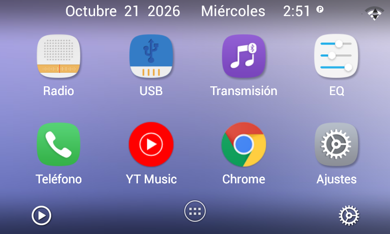
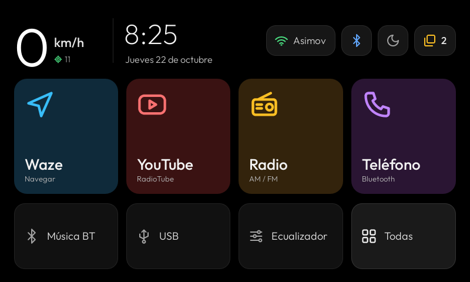
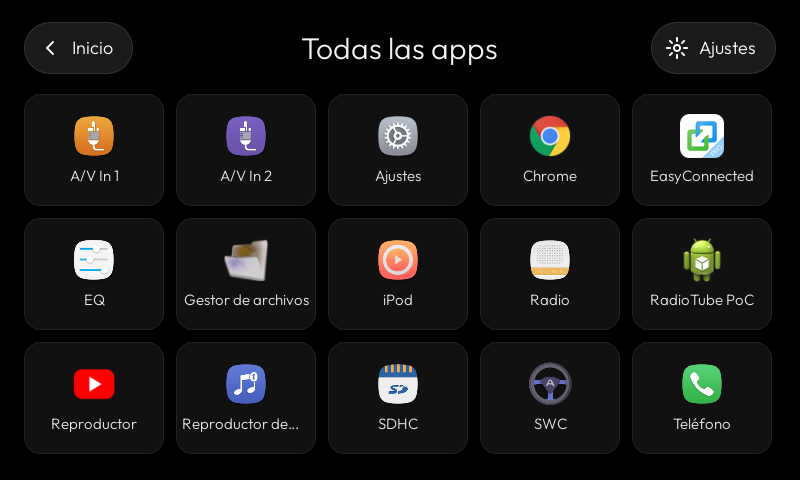
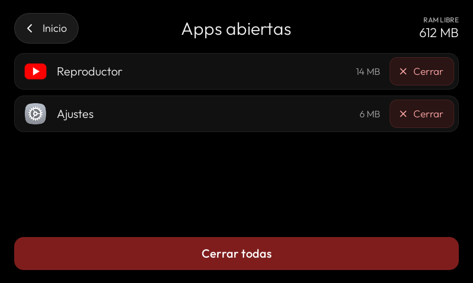

# Launcher para la radio ADAYO AC822X

Un launcher hecho a medida para la radio **ADAYO AC822X** (la del Suzuki Swift): Android 4.2.2,
pantalla de 800 × 480, 850 MB de RAM y un procesador de 4 núcleos Cortex‑A7 a 1 GHz.
Reemplaza la pantalla de inicio de fábrica por una más liviana y pensada para manejar.

## Antes: el launcher de fábrica de ADAYO



## Ahora: este launcher

**Inicio:** velocidad del GPS en grande, hora, Wi‑Fi, Bluetooth, luna y apps abiertas arriba; botones grandes abajo.



**Todas las apps:**



**Apps abiertas,** con la RAM que usa cada una y un toque para cerrarlas:



## Qué tiene ahora que ADAYO no tenía

| Función | Launcher de ADAYO | Este launcher |
|---|---|---|
| Velocidad del GPS y satélites | no | **sí**, en grande en el inicio |
| Red Wi‑Fi | solo un ícono | **nombre de la red**; un toque abre los ajustes de Wi‑Fi |
| Ver las apps abiertas | no | **sí**, con la RAM que usa cada una |
| Cerrar apps | difícil: había que entrar a Ajustes → Aplicaciones y forzar la detención de cada una | **un toque** por app, o **Cerrar todas** |
| Atenuar la pantalla de noche | no | **sí**, botón de la luna; se recuerda al apagar el auto |
| Evitar el ruido de FM al encender | no: arrancaba en la última fuente, y con mala señal sonaba el ruido de la FM | **sí**: chip rojo que deja Bluetooth, que arranca en silencio |

## En resumen

- **La velocidad, en grande.** Lo que se mira de reojo al manejar: km/h del GPS con los satélites al lado.
  Sin señal muestra "–", nunca una velocidad vieja.
- **Botones grandes**, cómodos con el auto en movimiento: cuatro principales (Waze, YouTube, Radio, Teléfono)
  y cuatro chicos (Música BT, USB, Ecualizador, Todas las apps). **Manteniendo apretado** un botón grande se
  elige qué app abre.
- **Apps abiertas:** cuántas hay, cuánta RAM usa cada una, y un botón para cerrarlas (una o todas).
- **Luna:** oscurece la pantalla de inicio cuando el brillo molesta de noche. Otro toque, normal.
- **Sin ruido de FM al dar contacto:** la radio retoma la última fuente del sistema. Si quedó en FM aparece un
  chip rojo; un toque la deja en Bluetooth, que arranca en silencio.
- **Liviano:** sin widgets, sin fondo de pantalla, sin base de datos y sin librerías.

## Consumo

| | Antes (launcher de ADAYO) | Ahora (este launcher) |
|---|---|---|
| RAM del launcher (PSS) | 18,9 MB recién abierto · 22,3 MB tras horas de uso | **8,4–8,8 MB** |
| CPU con el inicio en pantalla | ~0 % | **0 %** (en reposo ninguno gasta) |
| Tamaño del APK | 7,5 MB | **118 KB** (64 veces más chico) |

Medido en la propia radio con `dumpsys meminfo`, `top` y `ls -l` el 21 y el 22/10/2026, abriendo el launcher de ADAYO
un momento para medirlo en las mismas condiciones.
La **RAM libre del equipo** pasó de ~20 MB a cientos de MB, pero eso vino sobre todo de desactivar apps que no se
usaban (servicios de Google, etc.), no solo del launcher. Por eso no está en la tabla.

## Instalar

Hace falta ADB por Wi‑Fi hacia la radio (puerto 5555). `install.sh` compila el APK y lo instala usando el cliente
ADB en Python de [CleanYourTV](https://github.com/Gathin23/cleanyourtv) (`tools/tv.py`), clonado al lado de este repo:

```bash
RADIO_HOST=<ip de la radio> ./install.sh
```

En la radio, al pulsar Home, elegir **Inicio Swift → Siempre**. Algunas funciones (cerrar apps que se resisten,
el chip de la FM) usan el ADB local de la propia radio.

## Volver al launcher de ADAYO

Ajustes → Aplicaciones → Inicio Swift → **Borrar valores predeterminados**, y en el siguiente Home elegir el de
ADAYO. El launcher de fábrica nunca se desactiva.

La base de fuentes de ADAYO que toca el chip de la FM tiene su respaldo original en [`docs/adayo/`](docs/adayo/).

## Cambiar botones

`app/src/main/java/com/swift/radiohome/MainActivity.java`, tablas `BIG` y `SMALL` (paquete y actividad de cada app).

## Créditos

Hecho por **Rafael WT** con **Claude** (Anthropic). Fuente Outfit (licencia OFL, en `app/src/main/assets/fonts/`).
